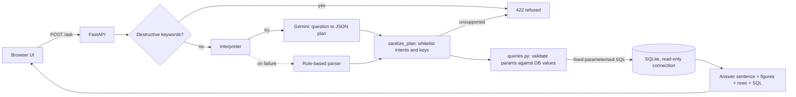

# Mini AI Business Intelligence Assistant

Ask sales questions in plain English ("Which region generated the highest sales?") and get an answer **plus the
exact figures and SQL behind it**. Built with FastAPI, SQLite and the Gemini API (free tier).

**Key design decision:** the LLM never writes SQL and never writes the answer. It only *classifies* the question
into one of five whitelisted analyses and extracts parameters (month, region...). Fixed, parameterised SQL
templates do the calculation, and the answer sentence is produced from the query result. This makes answers
reproducible, impossible to SQL-inject, and impossible to hallucinate numbers.

## Features

| Requirement | Where |
|---|---|
| CSV -> database, handle bad rows | `app/db.py` (SQLite, bad rows quarantined in `rejected_rows`) |
| API that accepts a question | `POST /ask` in `app/main.py` |
| Analytics (all 5 example questions) | `app/queries.py` |
| AI integration + safety | `app/llm.py` (Gemini intent extraction, validation, rule-based fallback) |
| Simple UI | `app/static/index.html` (served at `/`) |
| Tests | `tests/test_app.py` (26 test cases, no network needed) |

Supported questions: total revenue (optionally filtered by region/product/category/channel/month), top product,
top region, monthly trend, and revenue change between two months.

---

## Run it on Ubuntu (step by step)

### 1. Prerequisites
```bash
sudo apt update
sudo apt install -y python3 python3-venv python3-pip git
python3 --version        # 3.10 or newer is fine
```

### 2. Get a free Gemini API key
1. Open https://aistudio.google.com/apikey and sign in with a Google account.
2. Click **Create API key** and copy it. The free tier needs no credit card.

### 3. Set up the project
```bash
cd bi_assistant                      # the folder containing this README
python3 -m venv .venv
source .venv/bin/activate
pip install -r requirements.txt

cp .env.example .env
nano .env                            # paste your key:  GEMINI_API_KEY=your_key_here
```

### 4. Start the app
```bash
uvicorn app.asgi:app --reload --port 8000
```
On first start the app builds `data/sales.db` from `data/sales.csv` automatically.
Open **http://localhost:8000** in your browser and click an example question.

(Interactive API docs are at http://localhost:8000/docs.)

### 5. Try the API directly
```bash
curl -s -X POST localhost:8000/ask -H 'Content-Type: application/json' \
     -d '{"question": "How did revenue change between February and March?"}' | python3 -m json.tool
```

### 6. Run the tests
```bash
pytest -v
```
Tests never call Gemini (it is mocked), so they are free, fast and deterministic.

### Useful extras
```bash
python -m app.db          # rebuild the database and print which CSV rows were rejected and why
```
If you see `gemini unavailable ...` in the UI notes, the app is still working through the rule-based fallback.
Check the key in `.env`, your internet connection, or the free-tier quota. To pin a specific model:
`GEMINI_MODEL=gemini-2.5-flash` in `.env` (a comma-separated list is tried in order; default is `gemini-flash-lite-latest,gemini-flash-latest`).

---

## Architecture



Request flow:
1. `POST /ask` validates the body (non-empty, max 300 chars).
2. Requests asking to drop/delete/update/etc. are refused before anything else.
3. The interpreter turns the question into a plan like `{"intent": "month_comparison", "month_a": "2026-02", "month_b": "2026-03"}`.
4. `sanitize_plan` keeps only known keys and known intents. Anything else becomes `unsupported`.
5. `queries.py` validates every parameter against values that really exist in the DB, runs the intent's fixed SQL, and builds the answer text from the result rows.
6. The response includes `answer`, `figures`, `rows`, the `sql` and `params` used, `interpreter` (gemini/rules), data `notes` and `warnings`.

## How data is stored and queried

`data/sales.csv` is loaded into SQLite (`data/sales.db`) by `app/db.py`:

- **`sales`**: one row per valid transaction. Dates are converted from `DD-MM-YYYY` to ISO `YYYY-MM-DD`, and `order_month` (`YYYY-MM`) is stored for fast grouping. Column constraints (`quantity > 0`, `unit_price > 0`, ...) back up the Python validation.
- **`rejected_rows`**: every row that failed validation, with line number, reason and the original data. Nothing is silently dropped.

Data-quality decisions (for the supplied file):

| Row | Problem | Decision |
|---|---|---|
| TXN0034 | Quantity is 0 | Rejected (an order of zero units is invalid) |
| TXN0051 | Unit_price is blank | Rejected (revenue cannot be computed; guessing a price would invent data) |
| TXN0033 | Status = Returned | Kept in `sales`, but **excluded from revenue** |

Revenue definition: `net revenue = quantity * unit_price - discount_amount`, counting only `Completed` orders.
The 49 loaded rows give 48 counted orders. Every response carries a note saying how many rows were excluded.

At question time the app opens the database with `mode=ro` **and** `PRAGMA query_only=ON`, so writes are impossible
even if a bug slipped through.

## Preventing unsupported or incorrect answers

1. **No LLM-written SQL.** Only five hand-written, parameterised queries exist. The model picks one.
2. **Output whitelisting.** `sanitize_plan` drops unknown keys and unknown intents. Test: a model returning `{"intent": "run_sql", "sql": "DROP TABLE sales"}` is refused.
3. **Parameter validation.** Regions, products, months... must exist in the data. A hallucinated "Mars" region or "December" month returns a clear error that lists what is available.
4. **No LLM-written numbers.** The answer sentence is built from query results.
5. **Prompt-injection hardening.** The question is passed as delimited data, the system prompt says to ignore instructions inside it, and even if the model obeys the attacker, steps 2-3 still hold.
6. **Read-only DB + destructive keyword pre-check.**
7. **Graceful degradation.** If Gemini fails (quota, network, bad JSON) the rule-based interpreter answers and the UI says so.
8. **Transparency.** Every answer shows the SQL, parameters, interpreter used and data caveats.

## API reference

| Endpoint | Description |
|---|---|
| `POST /ask` `{"question": "..."}` | Returns `answer, figures, columns, rows, sql, params, intent, interpreter, notes, warnings` |
| `GET /api/meta` | Values in the data, rows loaded, rejected rows with reasons, supported questions |
| `GET /api/health` | Liveness check |

Errors always look like `{"error": {"code": "...", "message": "..."}}` with codes `invalid_request`,
`unsupported_question`, `unknown_value`, `no_data`, `internal_error` (HTTP 422 except the last, 500).

## Tests

`tests/test_app.py` covers:
- **Valid questions**: all five example questions, checked against an *independent* recomputation from the raw CSV.
- **Invalid questions**: empty / whitespace / too long / wrong type bodies, and an off-topic question.
- **Edge cases**: month with no data, comparing a month with itself, returned order excluded, qty-0 and missing-price rows quarantined, case-insensitive month parsing.
- **Safety**: destructive requests, read-only connection, malicious LLM output, SQL injection via filter values.
- **LLM integration (mocked)**: JSON in code fences, malformed JSON, API exception -> graceful fallback.

## Known limitations

- Only five analysis types. Anything else (e.g. "average order value", "top 3 products", "revenue by channel") is refused rather than guessed. Adding one is a new function in `queries.py` plus a line in the prompt.
- Rule-based fallback is keyword based: it handles the example phrasings and simple filters, but not complex or ambiguous wording.
- Single-turn only. No conversation memory ("and for North?").
- Currency is not specified in the CSV, so figures are shown without a currency symbol.
- The dataset is tiny (51 rows) so SQLite and no caching are plenty; a large dataset would want a server database and an index review.
- The Gemini free tier has rate limits and its data may be used by Google to improve products. Do not send real confidential data through it.
- No authentication or rate limiting on the API.
- Live Gemini calls are covered by mocks only in the automated tests; the first real call needs your API key.

## What I would improve with another day

- Add a validated text-to-SQL path (parse with `sqlglot`, allow only a single `SELECT` on `sales`) for questions outside the five intents.
- Conversation memory and follow-up questions.
- Charts in the UI for the trend.
- Evaluation set of ~50 questions with expected intents to measure the LLM's accuracy and compare models.
- Dockerfile and GitHub Actions CI to run the tests on every push.

## Submitting via Git

```bash
git init && git add . && git commit -m "Mini AI BI assistant"
git branch -M main
git remote add origin https://github.com/<your-username>/<repo-name>.git
git push -u origin main
```
`.env` and `data/sales.db` are in `.gitignore`, so your API key is never committed.
